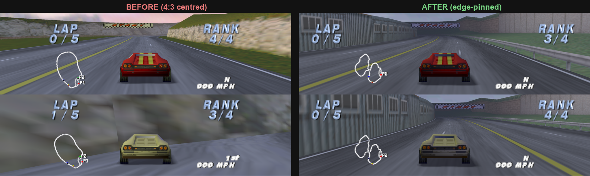
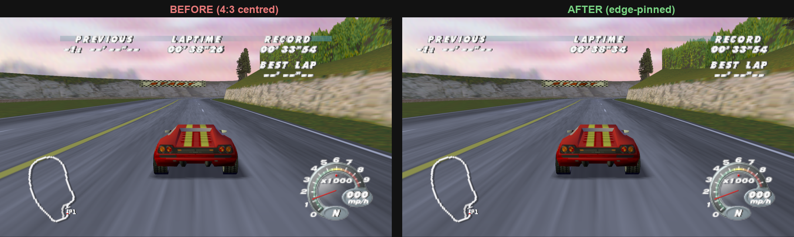
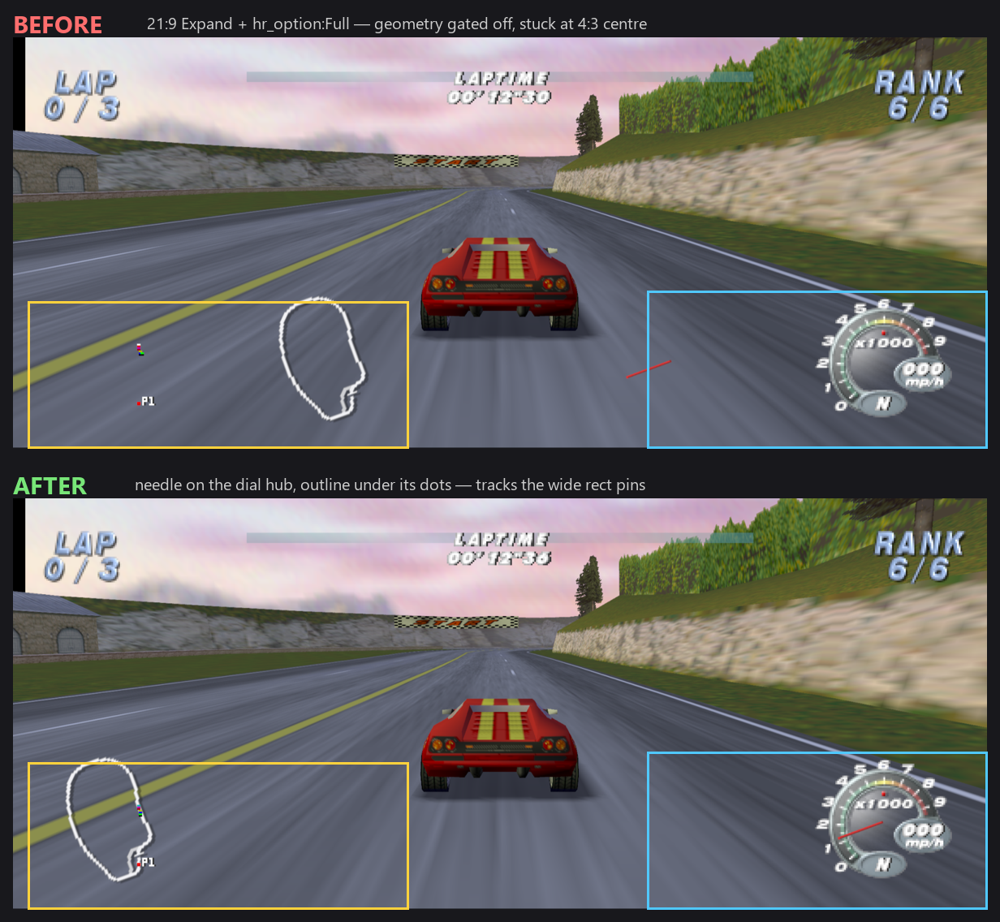

# HUD architecture and widescreen pinning

Status: historical measurement notes. The source and patch inventory are the
current contracts; the live captures below are evidence, not a fresh runtime
claim.

Historical labels in this page refer to local investigation themes: minimap
alignment, lens-flare aspect, split-screen HUD, split minimap, quad-split HUD,
and renderer aspect measurements. They are not current issue requirements.

Reference for anyone touching HUD/2D rendering. Everything here was
verified live against a driven 1P race (probe printfs in the recompiled C + decoded
frame captures of the display list). Names are splat-style (`lamborghini.syms.toml`
name space); runtime vram = splat − 0xC00.

## The 2D pipeline

- **DL write cursor: `0x800A39CC`** (runtime address). Every 2D helper allocates 8
  bytes per command: load cursor, store cursor+8 back, write two words through the old
  value. Native code can inject F3DEX (v1) commands at this cursor — this is the seam
  the widescreen brackets use (`src/lambo_hud_widescreen.c`).
- **Per-frame 2D dispatcher: `func_80050860`** (runtime 0x8004FC60), called each frame
  by the game-logic state machine `func_800030F8`. It is a mode-keyed wall of inline
  draw sections: 1P race, 2P split (two variants), pause, results, etc.
- The dispatcher's helpers (all take `(a0=data, a1=x, a2=y, ...)` with x,y in 320×240
  coords): `func_8004CCB4` text/string, `func_8004D468` glyph/number,
  `func_8004DB08` digit sequence, `func_8004C070` scaled text, `func_8005464C`
  table-driven (x,y,idx) draw.

## 1P race HUD element map (all verified live)

| Element | Drawn by | Call site (jal, runtime) | Anchor |
|---|---|---|---|
| Speedo dial face + digital speed + gear | `func_80056318` (runtime 0x80055718) | `0x8004FF60`, args (0, x=0xDC, y=0x98, speed float) | right |
| RANK label+value block | `func_800583B8` (0x800577B8) | `0x8004FF88`, (val, x=0x118, y=0x13) | right |
| LAP label+values block | `func_80058464` (0x80057864) | `0x8004FFA0`, (vals, x=0x28, y=0x13); draws label at x+2, values at x−0x10/x/x+0x10 | left |
| TIME label+value | `func_8004CCB4` pair at `0x800503E8`/`0x80050414` (x=0xA0) | centered — needs no pinning |
| Speedo NEEDLE | geometry built INSIDE `func_80056318`: one `G_MTX LOAD\|MODELVIEW` (word0 `0x01020040`) + rotation MULs + static DL; pivot trans ≈ (1000, −690) model units | right (via matrix nudge, see below) |
| Minimap track outline | 3D geometry via the RACE PERSPECTIVE projection, emitted by the frame-builder tail (splat `func_8004384C` flow): camera-space `translate(-2.05, -2.4, 0)` built by the `func_80075278` jal at `0x80043C88`, then static-Mtx/tilt MULs, then polyline emitter `func_80045BDC` (runtime 0x80044FDC). The menu track maps use a different routine — `func_80044E2C` (runtime 0x8004422C, x·5−800 ortho translate), 14 call sites, all menus. | left (issue #41: hook rewrites the translate x by −1.09 camera units, verified live; env `LAMBO_WS_MINIMAP_OUTLINE_DX` overrides) |
| Minimap car dots + P1 label + player arrow | `func_80054FFC` (0x800543FC), jal `0x80050588`; a2/a3 = cos/sin of CAR HEADING (arrow rotation); dots are 2×2 texrects, arrow is 2 quads via pool `G_MTX LOAD`s whose translate is `((x−158)·10, (119−y)·10)` — exactly 10 units per game px | left (issue #41: LEFT bracket for the rects, −533-unit matrix shift for the arrow) |
| Top translucent bar | static DL `0x80167170` (one 296×6 texrect, teal prim color) via projection MTX at `0x800A2C40` | centered |
| Sun lens flare | `func_80036854` (race path, BEFORE the HUD): chain of 10 translucent "ghost" texrects (alphas 0x82–0xDD, pastel prim tints) traced from the sun's projected screen pos; loop ≈ `0x800361C0`..`0x80036A58` | tracks the sun (issue #40: `gEXSetRectAspect(STRETCH)` bracket at `0x800361BC`/`0x80036A60` → `invRatioScale=1.0`, un-squished + full-width scissor; natives in `src/lambo_flare_widescreen.c`; no-op at 4:3) |

Traps discovered the hard way:
- `func_800717E0` (0x80070BE0) is a DIAL ORCHESTRATOR for an **alternate dial style /
  other modes** — it does NOT run in a normal 1P race (the 1P path branches around it
  right after the needle/minimap call at `0x80050588`).
- `func_80054FFC` looks speed-driven (cos/sin floats) but is the MINIMAP overlay, not
  the needle. Pinning it detaches dots/arrow from the track outline.
- `func_80058C48(a0=1..5, 160, 112)` correlates with gear but is a centered element
  (draws in menus/other screens too) — not the needle.
- 2P split is TOP/BOTTOM: sections at `0x80050CE8`/`0x80050D00` (y=0x10) and
  `0x80050F2C`/`0x80050F44` (y=0x80). RANK x=0x10E, LAP x=0x28 per half —
  same left/right anchors as 1P (issue #42: now hooked, see below).

## Mode dispatch & per-mode HUD (issue #42, verified live 2026-07-06)

`func_80050860` keys on the **player count** at `0x800CE6A4` (`$s0`): `==1` → 1P
section, `==2` → 2P top/bottom (`L_80050BEC`), `==3`/`==4` → quad-split (`L_800517A8`).
Verified by probe printf + `LAMBO_WARP=circuit:laps:car:<players>` (the dev warp's
players field boots straight into any of these). The **race mode** at `0x800CE6B4`
(`==0` time trial, `==2` single race) sub-branches *within* the 1P section.

| Mode | Reach | RT64 output | HUD pinning |
|---|---|---|---|
| 1P arcade | `players=1`, `0x800CE6B4=2` | stretched wide | done (#2/#41) |
| 1P time trial | `players=1`, `0x800CE6B4=0` (`LAMBO_WARP_MODE=0`) | stretched wide | done (#42): PREVIOUS left, RECORD/BEST-LAP right; LAPTIME centred; speedo+minimap shared with 1P (already pinned) |
| 2P split | `players=2` | stretched wide (top/bottom, full width) | done (#42/#56): per half RANK right, LAP left, speed readout right, alt-dial gauge tracked by the bracket's matrix walker, **minimap pinned left** (2D per half) |
| 3P/4P | `players=3`/`4` | **full widescreen quarters** (`G_EX_ORIGIN_WIDE` tag; was pillarboxed 4:3) | 3D views done; per-quadrant HUD text pinning is a follow-up (see below) |

Before/after (widescreen output, edge-pinning off vs on):

Details verified live:
- **2P split** (`L_80050BEC`): each half reuses the 1P RANK (`func_800583B8`, x=0x10E)
  / LAP (`func_80058464`, x=0x28) helpers, so the same `pin_right`/`pin_left` brackets
  apply per call site (top `0x80050CE8`/`0x80050D00`, bottom `0x80050F2C`/`0x80050F44`).
  The per-half speed/place readout is drawn by the **alternate-dial orchestrator**
  `func_800717E0` (a0 = player index; not in a 1P race) on the RIGHT (x=0xDC) — the
  whole DIALORCH call is bracketed `pin_right` (top `0x80050E0C`, bottom `0x80051050`).
  This pins the texrect **numbers**; `func_800717E0` also builds a **gauge as geometry**
  (via `func_80075278`, the modelview-translate builder behind the 1P needle), which
  `gEXSetRectAlign` can't move — but the bracket is `pin_right`/`pin_reset`, and the reset
  runs the same **matrix walker** as the 1P needle over the whole call span, so any gauge
  `G_MTX LOAD` inside `func_800717E0` (it calls `func_8006FC68` for the dial) is shifted
  with the numbers. No separate hook needed; verified live no gauge floats centred (#56).
  The section-C tail branches to `L_800517A0`, so the 1P-style sections at
  `0x800512xx`/`0x800515xx` never run in 2P.
- **Time trial** (mode-0 branch `L_8004FFB0`, `beq` at `0x8004FF70` skips RANK/LAP):
  its top row is all texrects (`func_8004D468` glyph / `func_8005464C` table draw), so
  one rect-align bracket per side covers a whole multi-glyph cluster — left cluster
  PREVIOUS (draws `0x8004FFF8`..`0x800501D8`), right cluster RECORD+BEST-LAP (draws
  `0x800501F4`..`0x80050274`). The reset's matrix walker finds no `G_MTX LOAD` here.
- **2P minimap** (#56) is pinned LEFT per half. Unlike 1P — where the track outline is
  3D geometry through the race perspective projection (center-anchored under Expand) and
  needs a separate camera-space shift — the *2P* minimap is drawn ENTIRELY as 2D texrects
  by the overlay `func_80054FFC` (dots + P1 + player arrow + the track outline). Verified
  live: the whole composite moves together under a single LEFT rect-align bracket, and the
  1P 3D outline builder (`func_8004384C` @ `0x80043F4C`) never fires in 2P (its output is
  the dead merge sibling `func_800448DC` — nothing calls it). So each half's overlay call
  gets the same LEFT bracket as the 1P minimap (`lambo_ws_minimap_pin_2p` = `pin_left`,
  then `lambo_ws_minimap_reset` for the arrow's LOAD matrix): top `0x80050DB4`, bottom
  `0x80050FF8`. No 3D hook or camera-unit calibration, and no aspect scaling — RT64's
  `hr_option` gives the rect pins the right edge travel at every aspect (verified 4:3
  no-op, 16:9 Clamp16x9, 21:9 Full).

### 3P/4P split-screen widescreen (quadrant views)

Unlike 2P (top/bottom, each half full-width, so RT64 stretches them for free), 3P/4P split
into a 2×2 grid: each player's 3D view is a **half-width** quadrant viewport. RT64's Expand
only stretches a viewport that covers the *whole* framebuffer width (`useWideViewport` /
`adjustAspectRatio`, keyed on `coversWholeWidth` against `fbPair.scissorRect`), so a quadrant
falls through to the squeeze path → the whole composite is a centred 4:3 image with dark
pillarbars.

Fix (two coupled pieces):
- **RT64 (`patches/0009`)**: a new viewport-origin tag `G_EX_ORIGIN_WIDE` (`0xC00`, ≥ `NONE`
  so `movedFromOrigin()` leaves the translate untouched). A perspective viewport carrying it
  takes the wide branch in *both* gates — `rt64_projection_processor.cpp` (FOV Hor+) and
  `rt64_framebuffer_renderer.cpp` (NDC scale) — skipping the whole-width requirement. The
  magic is that a quadrant is a **uniformly-halved copy** of the whole frame (160×120 vs
  320×240, both 4:3), so its own widescreen scale equals the global `aspectRatioScale` RT64
  already computes, and its native viewport already lands in the correct output half
  (NDC `[-1,0]`/`[0,1]`). So the existing global scale places and widens each quadrant
  correctly with no new math; `computeOrigin()` maps `WIDE` to centre so the half-width
  scissor is still produced. No-op at 4:3 (`aspectRatioScale == 1`).
- **Game (`func_800030F8`)**: `viewportOrigin` is sticky global RSP state, so
  `gEXSetViewportAlign(WIDE)` is emitted once before the scene's DL calls (hook at
  `0x800044DC`) and reset to `NONE` at the entry of the 2D HUD dispatcher `func_80050860`
  (`0x8004FC60`) — which `func_800030F8` calls after emitting the whole 3D scene. This spans
  every quadrant viewport (six perspective viewports/frame: four quadrants + full-width
  sky/minimap; `WIDE` is a no-op on the already-full-width ones) but resets before the HUD's
  2D/ortho draws. Natives self-gate on the player count (`0x800CE6A4 >= 3`): 1P/2P never set
  `WIDE`. Verified live 4:3 (no-op) / 16:9 / 21:9, both 3P and 4P (`src/lambo_hud_widescreen.c`,
  `lambo_ws_split_wide_begin`/`_end`).

### 3P/4P per-quadrant HUD text pinning (issue #78)

The quad HUD is drawn by `func_80050860`'s quad section (`L_800517A8`..`L_80052C00`, quad-only:
the 2P tail's `L_800517A0` branches straight past it). Element map (all verified in the
generated code; y needs no repositioning, only x):

| Element | Draw sites (runtime vram) | 4:3 x | Pin |
|---|---|---|---|
| RANK digits (`func_8004CCB4`) | Q1 `0x800517E0`, Q2 `0x80051814`, Q3 `0x80051848`, Q4 (4P) `0x80051890` | 0x20 / 0x110 | LEFT / RIGHT |
| Speed digits + unit glyph (`func_8004D468`; two branches on the unit flag `0x800CE802`) | mph: `0x80051948/64`, `0x800519D8/F4`, `0x80051A68/84`, 4P `0x80051B0C/28`; km/h: `0x80051B80/9C`, `0x80051BEC`+`0x80051C08`, `0x80051C58/74`, 4P `0x80051CD8`+`0x80051CF4` | 0x14–0x46 / 0xEB–0x11D | LEFT / RIGHT |
| LAP counters (`func_80058530`) | `0x80051D0C`, `0x80051D24`, `0x80051D3C`, 4P `0x80051F88` | 0x60 / 0xB4 | none (centre-anchored untagged = tracks the divide) |
| Lap-notify glyph (digit or "N") | `0x80051DC4`, `0x80051E4C`, `0x80051ED4`, 4P `0x80051F70` | 0x19 / 0x118 | LEFT / RIGHT |
| Per-player tag texrects (inline DL, 2 per quadrant, shared texture `0x801651B0`) | blocks bounded by labels `0x80051F90`/`0x8005245C`/`0x80052648`/`0x80052834`/`0x80052A34` | lr 46–59 / 299–301 | LEFT / RIGHT |
| Message glyphs (quadrant-centred) | `0x80052AA0`, `0x80052AE0`, `0x80052B20`, 4P `0x80052B74` | 0x50 / 0xF0 | 25% / 75% fractional origin |
| 3P map panel (overlay `func_80054FFC` at centre 240,180) | jal `0x80052BB4` (3P only) | centred on 240 | 75% origin + arrow matrix walker (+266.7 units·scale) |
| 4P map overlay (same helper at screen centre 160,120) | jal `0x80052BE8` | centred | none (untagged = centred) |

Mechanism notes specific to this section (see `lamborghini.us.toml` issue-#78 block and
`lambo_ws_quad_*` natives):
- **Hook text at a branch-target label runs on EVERY incoming path** (N64Recomp emits the
  label before the hook text — `recompilation.cpp`, label pass before `process_instruction`).
  Per-element scissor pin/reset pairs therefore cannot stay balanced across the 4P-only
  branches; instead ONE full-width scissor spans the whole section (`lambo_ws_quad_text_begin`
  at `0x800517D0`, flag-guarded pop at the shared exit `L_80052C00`) and the intermediate hooks
  only switch the sticky rect-align state, which is idempotent and safe at merge labels.
- **Fractional origins**: RT64's `computeOrigin` is generic (`origin/0x400` of the output
  width, `rt64_framebuffer_renderer.cpp:57`), so quarter-centre pinning uses origins `0x100`
  (25%) / `0x300` (75%) with quarter-pixel rebases `-320`/`-960` (same pattern as `pin_right`'s
  `-1280`): an element at game-x 80/240 sits exactly on its quarter's centre at any aspect and
  `hr_option`.

## Injection mechanism (no MIPS patch pipeline needed)

`[[patches.hook]]` in `lamborghini.us.toml` (`func`, `before_vram`, `text`) injects raw
C text before the instruction at `before_vram` when N64Recomp emits the function
(vendored N64Recomp `recompilation.cpp:129`). The text runs in the recompiled function
scope (`rdram`, `ctx` available; implicit declaration links against natives).
Rules:
- `before_vram` must not be a branch delay slot.
- Place hooks BEFORE the game's cursor-allocation block for the following command
  (the alloc pattern is ~5 instructions: `lw` cursor / `addiu +8` / `sw` / `sw` to
  stack), or your injected commands land after the game's next command.
- Regenerating RecompiledFuncs: `N64Recomp.exe lamborghini.us.toml` from repo root,
  then delete `build/**/libRecompiledFuncs.a` before rebuilding.

## RT64 extended-GBI facts (verified against lib/rt64 source + live)

- Enable hook: `G_SPNOOP`(0x00 on F3DEX v1) with magic `0x525464`, w1 =
  `(1<<28)|0x64`. Must be emitted before any `0x64` extended command; idempotent.
- `gEXSetRectAlign` affects ONLY rects (texrects/fillrects). LEFT pin =
  `(LEFT, LEFT, 0,0,0,0)`; RIGHT pin = `(RIGHT, RIGHT, -1280, 0, -1280, 0)`
  (offsets are quarter-pixels; −1280 re-bases the 320-wide coordinate space);
  reset = ORIGIN_NONE (0x800). At 4:3 output the math degenerates — no gating needed.
- The game's own scissor is untagged, so RT64 centers it on 4:3 and CROPS moved rects.
  Each bracket must push + set a full-width extended scissor
  (`gEXSetScissor(0, LEFT, RIGHT, 0,0, 0,240)`) and pop on reset.
- **Never wrap a GEOMETRY draw in a wide scissor**: the draw merges the wide scissor
  into the fbPair scissor, flipping RT64's `coversWholeWidth` heuristic
  (`rt64_framebuffer_renderer.cpp:1493`) for every untagged full-width-viewport
  geometry in that frame — the minimap visibly squeezes toward center.
- `gEXSetViewportAlign` with a non-NONE origin puts geometry on a squeezed
  screen-scale path (not a pure translation) — unusable for matching a rect-pinned
  element. Untagged geometry renders WIDE (stretched viewport, projection used as-is)
  only when its scissor∩viewport covers the full fbPair width AND origin is NONE
  (`useWideViewport`, rt64_framebuffer_renderer.cpp:1493); otherwise RT64 squeezes it
  back to the 4:3 center (`screenScale.x = 320/wideWidth`). The 2D ortho HUD section
  (needle, minimap arrow) is on the SQUEEZED path — same 4:3-centered placement as
  untagged rects. The 3D world (and the in-race minimap outline drawn through the race
  perspective projection) is on the wide path, but Expand widens perspective FOV, so
  fixed camera-space objects stay center-anchored at the 4:3 pixel scale.
- Geometry elements that must track a rect-pinned element are therefore moved in
  GAME space (edit their modelview translation in RDRAM after the game builds it,
  before the task is submitted). See `lambo_hud_widescreen.c`: walk the emitted DL
  between bracket cursors for `w0 == 0x01020040`, patch matrix element [3][0] (int at
  byte 24, fraction at 0x44). On the squeezed 2D path the required travel at 16:9
  Clamp16x9 is (wideW − H·4/3)/2 screen px = 160/3 game px; the 2D matrices use 10
  units per game px, so |Δ| ≈ 533 units (the needle's live-calibrated +530 matches
  this analytic value — the old "≈0.065 game-px/unit" note was a misreading of a rough
  screenshot measurement). That 533/-533/-1.09 is the **16:9** magnitude; issue #67
  scales each by `lambo_ws_hud_shift_scale_for_aspect()` (0 at 4:3, 1 at 16:9, larger
  for wider outputs) so the geometry tracks the rect pins at any Expand output aspect and
  any `hr_option`, not only the shipped `Clamp16x9` defaults. **The scale keys off the
  aspect the rects EFFECTIVELY pin to** (`lambo_ws_get_hud_rect_aspect_bits()`), NOT the
  raw output aspect — because RT64's rect pins honour `hr_option` via `extAspectPercentage`
  (`rt64_workload_queue.cpp:159-183`): `Full` reaches the real edges, `Clamp16x9` stops at
  16:9 (so at 21:9 the rects travel only ~44% of the way), `Original` doesn't move at all.
  Keying off the raw output aspect would over-translate the geometry
  past the clamped rects on a non-`Full` ultrawide. The effective aspect is 4/3 (0-travel)
  for any non-Expand config or `Original`, so no separate config gate is needed. See the
  `lambo_ws_hud_*` inline helpers in `src/lambo_hud_widescreen.h` (host-unit-tested in
  `tests/test_hud_shift_scale.c`).

  

## Debug technique that finally worked

Printf probes in the (git-ignored) generated `RecompiledFuncs/funcs_*.c` — insert at
`RECOMP_FUNC void <fn>(` printing `ctx->r4..r7`, rebuild incrementally, drive a race,
group stderr by line. To see actual DL bytes, dump RDRAM around the cursor from a
native hook to a file and decode offline (F3DEX v1 decoder in session scratch;
`tools/` has no committed copy — rederive from this table if needed). The stale
region PAST the cursor is the previous frame's tail — same layout, already-complete.

## Stable HUD texture identities (2026-10-15)

Status: the tile and ownership contracts below are checked in source and host
fixtures. Runtime measurements are recorded separately below.

USA dial tiles load 40x6 and 16x57 texels with 64x8 and 16x64 wrap masks.
The six circuit maps load 80x80 texels with 128x128 masks. Rank suffixes load
96x8 texels with a 128-wide mask. RT64 v5 can hash unused TMEM padding when
those masks exceed the loaded rectangle. A later load can change the identity
without changing the texture's loaded bytes.

One exact-match table in `src/lambo_hud_texture_bounds.cpp` covers both dial
sources (physical 0x160140/0x160508), all six map sources (0x121A88, 0x122710,
0x123398, 0x124020, 0x124CA8, 0x125930), and suffix source 0x165028.
Direct physical/KSEG0 source pointers are normalized before matching.
Matching checks the render-tile index, format/stride, wrap/mirror bits and F2
bounds. Only the S/T clamp bits of matching F5 command words are rewritten.
Mirror bits survive. Unknown contracts pass through unchanged; matching is
idempotent. Geometry commands, texture bytes and UV coordinates are untouched.
Clamp changes sampler addressing, so filtering at the loaded rectangle's edge
may change pixels. Pixel equivalence has not been measured and is not claimed.

### Producer ownership and microcode gate

`lambo_graphics_task_prepare` runs on the guest game thread at 0x80005728,
before `osSendMesg` publishes a completed graphics task. The same hook then
copies sunlight diagnostic records, so snapshots include these corrections.
Both RT64 and `LAMBO_HEADLESS=1` receive the same corrected HUD/fog commands.
The dial no longer depends on a paired widescreen bracket. Neither renderer's
`send_dl` writes HUD or fog commands.

USA frame-builder evidence: 0x800054E0..0x80005518 puts the scheduler-message
pointer in t5; the hook receives t5 + 0x10, the embedded OSTask. Its two accepted
physical addresses are 0xBF1E8/0xC6C38. The corresponding builder task pointers
are 0x800BF240/0x800C6C90 and root lists are at builder task + 0x1C0
(OSTask + 0x218). OSTask fields are native u32 words in word-swapped RDRAM:
type at +0, microcode code pointer at +0x10, data pointer/size at +0x18/+0x1C,
and display-list pointer at +0x30. Sizes are bytes. The gate requires type 1,
code at physical 0x86B60, data at 0x8F210, data size 0x800, and the exact slot's
root. The builder does not author `ucode_size` (+0x14); it is not an identity
gate. These values come from 0x800055D0..0x80005620 and 0x80005524..0x8000555C.
Unknown tasks/microcodes fail closed before decoding.

The scheduler's DP completion fence releases a reused slot to the producer;
the game loads assets and builds lists before this hook publishes the task.
The walker also rewrites matching commands in asset sublists, not just the task
arena. Moving all HUD/fog writes to the guest producer removes the graphics
thread's read/modify/write window against asset-loading DMA. This is not a new
DMA lock or permission to reuse assets referenced by pending tasks: the
[race-start asset deferral](sky-panorama.md#race-start-asset-lifetime) remains
required. Only copied fog words, physical offsets and the RAM allocation
identity survive a walk; no guest command pointer is retained. The intended
replacement is correct bounds in source-level HUD emitters as decompilation
progresses.

### Idempotent fog correction

`FogRewriter` keeps an authored word and its most recent corrected word per
physical command offset, on the guest producer only. If the current opcode and
word equal that previous output, another visit recomputes from the authored
word. A different opcode or word replaces the baseline. Visiting a non-fog
command removes that address's record; a different RAM allocation clears all
records. Default fog settings create no records for unchanged commands.

This makes duplicate sublist calls, repeated task preparation and shared asset
lists fixed points for a given policy. Changing the density or multiplayer
match recomputes from the same baseline; returning to default settings restores
it and removes the record. It does not assume that lists are rebuilt each
frame. The fixture checks 0.5 on consecutive prepares, shared lists across both
task slots, fresh emissions at reused addresses, policy changes, zero and
saturated scales, colour restoration and separate RAM allocations.

An external rewrite with exactly the previous output's opcode and bytes is
indistinguishable from an unchanged correction and retains its stored baseline.
This is process-local producer metadata, not part of a portable save-state.
Correcting the source-level fog emitters would remove that ambiguity.

### Shared traversal and verification

`src/lambo_f3dex.h` traverses the root once for both HUD and fog policy. It
tracks segments and calls/tail branches, uses bit 16 for G_DL push/no-push,
skips extended-command payloads, and only dereferences the native 8 MiB RAM.
`resolve` rejects all unaligned or out-of-range targets; it does not inspect
extended heap lists. An invalid call returns to its parent, while an invalid
tail branch ends that list. The panorama's extended heap targets are rejected
by the same 8 MiB address check. The maximum call depth is 16 below the root, with one shared
200,000-command budget. Reaching either limit aborts the walk and writes a
`gfx-policy` warning. Already visited matches remain corrected; later matches
can retain unstable hashes. Debug logging samples command counts, HUD matches
and producer time in microseconds for the first 12 tasks and every 60th task.

Focused CTests are `lambo_hud_texture_walk`, `lambo_hud_hash_padding` and
`lambo_hud_rt64_contract`. Assertions stay enabled in Release. The producer
fixture checks every source contract, mirror variants, exclusion, idempotence,
root-reachable dial commands without brackets, shared fog policy, segmented
calls, bit-16 branches, extended payloads, unknown microcodes, depth 16 versus
17, malformed addresses and the global command budget. The real RT64 hasher
test varies padding 256 ways: wrapped identities vary, bounded ones do not,
and changing a loaded texel still changes its hash.

The required dependency audit is pinned to RT64
`f0728a2520d5aa735886240de3fee75cc805f6d6`. `State::flush` in
`src/hle/rt64_state.cpp` derives `clampS/clampT` from `cms/cmt`, selects the
minimum of tile bounds and masks for `sampleWidth/sampleHeight`, then uses those
sizes for TMEM loading/hashing. The pin test fails on a gitlink change, requiring
review of that chain before accepting a new pin. The hasher test alone does not
exercise the sampler-size decision. Dependency patches are unchanged.

### Runtime verification of the producer correction

Windows x64, GCC 15.2.0 Release, USA ROM SHA-256
`cab2467684a58bc19c787423d704a961aa497629763367d9fe691172de58591c`:

- `build.ps1 -PreserveSubmodules` rebuilt generated output and the full port;
  the Windows RDRAM reservation regression passed.
- Six focused CTests passed (HUD walker/hash/pin, sky panorama, interpolation
  tags and sunlight task records). The existing standalone HUD bracket test
  passed. The Python suite ran 137 tests: 131 passed and six optional tests
  were skipped.
- The headless smoke completed 600 replay frames and 601 swaps. Sampled race
  roots contained both dial contracts, one map setup and a suffix setup.
- RT64/D3D12 one- and four-player circuit-1 runs each completed the same
  600-frame replay and 601 swaps. Real root traversal reached both dial slices
  in 1P, the map in both layouts, and suffixes when drawn. Producer snapshots
  confirmed the unauthored `ucode_size` field is zero.
- With debug logging enabled, 21 sampled race tasks per run took a median
  40.3 microseconds (maximum 80.8) for 1P and 46.3 (maximum 60.7) for 4P.
  These covered 2,164-4,591 and 5,033-7,277 commands respectively. No traversal
  limit warning occurred. These are sampled producer costs on this machine,
  not an FPS comparison or a graphics-thread cost.
- A further 1P RT64 texture dump emitted the two documented bounded dial
  hashes and suffix hash, with sizes 40x6, 16x57 and 96x8 respectively.
  Geometry/pixel equivalence was not measured. Six-circuit pack verification
  and the earlier PR's visual captures were not repeated here.

For timing, use the smoke replay in a windowed circuit-1 run with `--verbose`,
then repeat with four players. `gfx-policy` logs counts and elapsed microseconds.
The fixed replay is `recordings/harness-smoke.jsonl`; both renderers can use
`tools/run_game_scenario.py` with isolated scenario/profile paths. Texture dumps
and task snapshots contain game data and stay local.

Vulkan startup exited with `0xC0000374` in this verification. The same failure
reproduced with the pre-correction executable identified by the companion
record's executable hash. D3D12 runs passed; this is not evidence of Vulkan
validation for this change. Related investigation:
[Vulkan heap-corruption issue](https://github.com/alondero/automobililamborghini-recomp/issues/111).

### Texture-pack coordination

The companion pack supplies dial identities 2e24c9fccec5cac4 and
93fb46ad45acf4d2, six bounded map identities, and suffix d7ea8162b91a5e1d.
Older alias-only HUD packs will stop replacing these tiles. Install the matching
[HUD texture pack](https://github.com/alondero/automobili-lamborghini-textures/pull/9).
Its verification record currently names base `cefbde5` plus a local patch digest,
not an exact tested `63b6c6b` checkout. That historical record does not confirm a
regeneration against `63b6c6b`; release coordination must record the exact port
revision used for the next pack verification.
